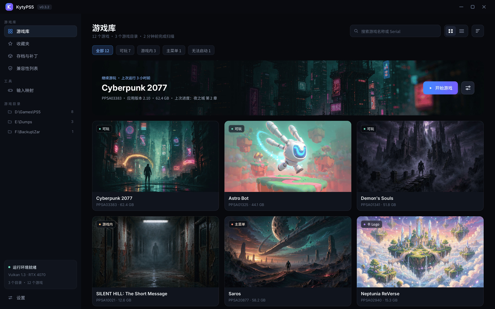
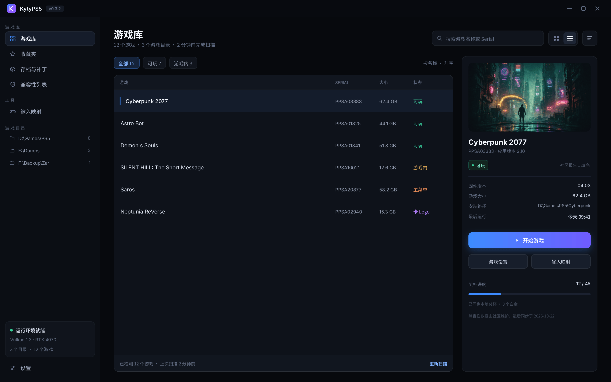
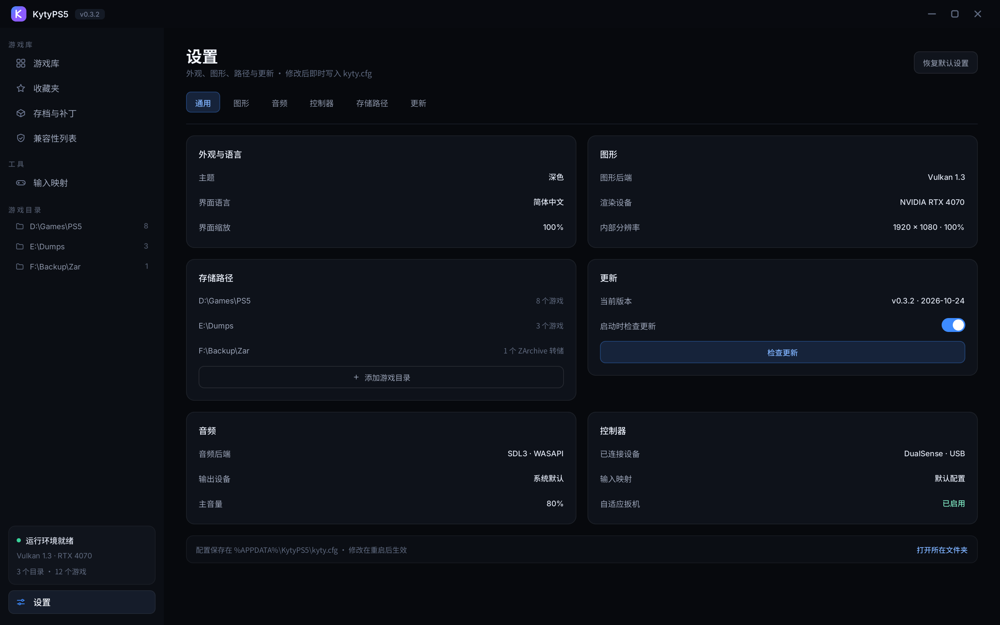

# KytyPS5 Launcher — 深色主机风 UI 设计规范

> 面向 `src/launcher`（Qt 6 Widgets）的界面视觉规范与落地说明。
> 设计稿：Ardot `file/739829717228825`（1440×900 ×3 画板，可编辑）
> 样式表：`src/launcher/styles/kytyps5-console.qss`
> **浏览器版（推荐开发时对照）**：`docs/design/kytyps5-ui-spec.html`，组件可交互、截图 1:1、单文件自包含。

---

## 1. 设计目标

启动器的核心任务是**让人快速找到游戏并启动**，其次是处理路径、兼容性和设置这类"维护性"工作。因此：

- **游戏封面是主角**，界面本身的装饰要让位；所有容器都是低对比的深色块，只有封面和主按钮有颜色。
- **状态可见**：每个游戏都要一眼看出能不能跑（可玩 / 游戏内 / 主菜单 / 卡 Logo / 无法启动），而不是点进去才知道。
- **两种浏览姿势**：看封面挑选 → 网格视图；批量核对版本、大小、路径 → 列表视图 + 详情面板。两者共享选中项，随时切换。
- **设置是配角**：能改就行，不争夺注意力，用卡片分区 + 行式布局，避免表单感。

---

## 2. 屏幕

### 2.1 游戏库 · 网格视图



| 区域 | 规格 |
| --- | --- |
| 窗口 | 1440×900，自定义标题栏 40px（Logo 22px + 版本胶囊 + 窗口控制 32×24） |
| 侧栏 | 236px，`#0B0E14`，内边距 16/12；分组：游戏库 / 工具 / 游戏目录；底部运行环境卡 |
| 内容区 | 内边距 24/32，纵向 16 间距 |
| 页头 | 标题 23px Bold + 副标题 11.5px；右侧搜索框 264×36、视图切换 68×36、更多 36×36 |
| 筛选条 | 胶囊 28px 高，间距 8，选中态 `#16233A` + 边框 `#3D8BFF` 35% |
| 继续游玩 | 1140×160，圆角 16，图片铺满 + 左→右黑色蒙版，左侧文案块，右侧主按钮 38px |
| 游戏网格 | 3 列，卡 369×260（封面 207 + 信息 53），间距 16 |

**卡片解剖**：封面（左上角毛玻璃状态胶囊 22px）→ 标题 13px SemiBold → `Serial · 大小` 10.5px 弱化文字。整卡圆角 12，描边 `rgba(255,255,255,.07)`。

### 2.2 游戏库 · 列表视图 + 详情



| 区域 | 规格 |
| --- | --- |
| 表格 | 宽 800，圆角 12；表头 36px（10px 大写字距），行高 52 |
| 列 | 游戏（撑满）/ Serial 92 / 大小 68 / 状态 80，行内边距 14、列间距 12 |
| 选中行 | 底色 `#141C2B` + 左侧 2×20 蓝色指示条 |
| 详情面板 | 320 宽，内边距 16，圆角 12；封面 288×162 → 标题 17 Bold → 状态胶囊 + 社区报告数 → 信息四行 → 主按钮 38 → 两个次按钮 34 → 奖杯进度 → 备注 |

列表视图刻意**不显示缩略图**：这一屏是给"核对数据"用的，纯文本 + 固定列宽比封面更好扫。

### 2.3 设置



- 页头 + 右上「恢复默认设置」次按钮
- 标签页 30px 高：通用 / 图形 / 音频 / 控制器 / 存储路径 / 更新，选中态为浅蓝底胶囊
- 内容为 2 列卡片（562 宽，间距 16），卡片内边距 18、行距 10，每行：标签 11.5px `#9BA4B8` ↔ 值 11px `#DDE3EF`
- 底部配置路径条 40px 高，右侧「打开所在文件夹」链接

---

## 3. 设计令牌

### 3.1 颜色

| 用途 | 值 | 说明 |
| --- | --- | --- |
| 应用底色 | `#07090D` | 窗口、内容区 |
| 侧栏 / 浮层 | `#0B0E14` | 侧栏、配置条 |
| 卡片 | `#0E121A` | 表格、设置卡、详情面板 |
| 控件槽 | `#10141C` | 输入框、下拉、按钮底色 |
| 悬停 / 选中 | `#151C2A` | 通用悬停 |
| 选中强调底 | `#16233A` | 筛选胶囊、选中行、选中标签页 |
| 描边（弱） | `rgba(255,255,255,.06)` | 卡片外框 |
| 描边（强） | `#232B3A` | 控件外框 |
| 主文字 | `#F2F5FA` | 标题、选中项 |
| 次文字 | `#9BA4B8` | 标签、未选中导航 |
| 弱文字 | `#5F6A80` | 说明、表头、路径 |
| 主色 | `#3D8BFF` | 主按钮起点、选中指示 |
| 主色（高亮文字） | `#7FB3FF` | 链接、选中标签 |
| 辅色 | `#8B5CF6` | 主按钮渐变终点 |

**主色只允许出现在三处**：主操作按钮、当前选中项指示、可点击链接。其余一律灰阶。

### 3.2 兼容性状态色

> ⚠️ 与代码 `configurationItem.cpp::GetStatusColor()` 对齐时按下表调整，不要沿用旧值。

| 状态（代码枚举） | 现码值 | 建议值 | 依据 |
| --- | --- | --- | --- |
| `InGame` 游戏内 / 可玩 | `#2fb344` | `#37D399` | 深底上提亮，绿=可玩 |
| `MainMenu` 主菜单 | `#2f80ed` | `#3D8BFF` | 蓝=能进界面，与主色同族 |
| `Logo` 卡 Logo | `#f2c94c` | `#F2B33D` | 黄=启动早期失败 |
| `DoesntBoot` 无法启动 | `#e55353` | `#EF5A6F` | 红=完全不可用 |
| `Unknown` 未测试 | `#8a8a8a` | `#6B7488` | 冷灰=无信息 |

设计稿里的 Logo 状态用了紫色，是当时为了区分四个层级做的占位配色；**落地按上表**，保持"蓝=界面/黄=Logo/红=不启动"的语义，避免用户重新学习一套颜色。

### 3.3 字体与尺度

| 角色 | 字号 / 字重 | 字体 |
| --- | --- | --- |
| 页面标题 | 23 / 700 | Noto Sans SC |
| 条目标题（详情） | 17 / 700 | Inter |
| 卡片标题 | 13 / 600 | Inter（拉丁）/ Noto Sans SC（中文） |
| 正文 / 行值 | 11–11.5 / 400 | Noto Sans SC |
| 标签 / 表头 | 10 / 500，字距 +2% | Noto Sans SC |
| 数字与 Serial | 10.5–11 / 500 | Inter（等宽感更好） |

字阶：10 / 10.5 / 11 / 11.5 / 12.5 / 13 / 17 / 23。间距阶：2 / 4 / 6 / 8 / 10 / 12 / 16 / 20 / 24 / 32。
圆角：胶囊 999、卡片 12、控件 9、行内小件 6。描边统一 1px，不用阴影做层级（深色下阴影不可见），改用**底色差 + 描边**。

---

## 4. 组件规范

| 组件 | 规格 | 状态 |
| --- | --- | --- |
| 主按钮 | 高 38，圆角 9，`#3D8BFF → #7B5CFF` 横向渐变，白字 12.5/500，外发光 `#3D8BFF 30%` r18 | hover 提亮 8%，pressed 压暗，disabled 转 `#1B2434` |
| 次按钮 | 高 34–38，底 `#171E2B`，描边 `rgba(255,255,255,.07)`，字 `#C9D2E2` | hover 底 `#1C2433` |
| 图标按钮 | 28–36 方，圆角 7，无底 | hover `#151C2A` + 描边；checked 底 `#1D2534`；删除类 hover 转红 |
| 状态胶囊 | 高 22，圆角 6，底 `rgba(2,3,5,.62)` + 背景模糊 14，左侧 5px 色点 | 文字用状态色的浅色版（如 `#7BE3BE`） |
| 筛选胶囊 | 高 28，圆角 7，底 `#10141C` | 选中：底 `#16233A`、描边主色 35%、字 `#7FB3FF` |
| 表格行 | 高 52，内边距 14，底透明 | hover `#131A26`；选中 `#141C2B` + 蓝条 |
| 设置行 | 高 26，两端对齐，行距 10 | 值右对齐，弱化项用 `#5F6A80` |
| 开关 | 34×20，圆角 10，滑块 16 白 | 开 `#3D8BFF`，关 `#2A3140` |
| 下拉 | 高 30，圆角 9，右箭头 10×6 | focus 描边主色；弹层圆角 8 + 项高 24 |
| 滑动条 | 槽 4px 圆角 2，手柄 14px 白 | 已选区主色，未选区 `#1B2130` |

**空状态**：无游戏时表格区显示居中卡片——44px 图标 + "还没有添加游戏目录" + 主按钮「添加游戏目录」。这一条必须在实现里补，否则首次启动是一片黑。

---

## 5. QSS 落地映射

样式表已按"令牌 → 选择器"分节写好，主要映射：

| 设计令牌 | QSS 落点 |
| --- | --- |
| 应用底色 `#07090D` | `QDialog, QMessageBox { background }` |
| 侧栏 `#0B0E14` | `QComboBox`/`QLineEdit` 槽位与浮层 |
| 卡片 `#0E121A` | `QTreeWidget#cfgs_list`、`QGroupBox`、`QListView#cfgs_grid` 卡片 |
| 选中强调 `#16233A` | `::item:selected`、`QTabBar::tab:selected`、`QComboBox QAbstractItemView` 选中 |
| 主色 `#3D8BFF` | `QPushButton#ok_button` 渐变起点、`:focus` 描边、`QSlider::sub-page` |
| 状态色 | 不写进 QSS：由 `QLabel#game_status_indicator` 的内联 `background-color` 提供，QSS 只管 10×10 圆角 |
| 表格 | `QTreeWidget#cfgs_list` + `QHeaderView::section` + `::item` |

---

## 6. 接入步骤

1. **样式表**已生成：`src/launcher/styles/kytyps5-console.qss`，并已在 `resources.qrc` 注册为 `:/styles/kytyps5-console.qss`；同时新增三枚自绘图标 `chevron-down.svg` / `chevron-up.svg` / `check.svg`。
2. **快速预览**：把 `LauncherTheme::Initialize()` 里的路径改成新资源即可（改动一行）：

   ```cpp
   QFile style_sheet_file(QStringLiteral(":/styles/kytyps5-console.qss"));
   ```

3. **做成可选主题**（推荐）：`theme_combo` 增加一项 "Console"，`ApplyTheme()` 里按索引加载对应 qss，并强制深色调色板：

   ```cpp
   static void ApplyTheme(int theme) {
       // 固定深色样式必须配深色调色板，否则网格卡片与系统控件会回退成浅色
       QApplication::styleHints()->setColorScheme(
           theme == kConsoleTheme ? Qt::ColorScheme::Dark
                                  : (theme == 2 ? Qt::ColorScheme::Light : Qt::ColorScheme::Unknown));
       QFile f(theme == kConsoleTheme ? QStringLiteral(":/styles/kytyps5-console.qss")
                                      : QStringLiteral(":/styles/launcher.qss"));
       if (f.open(QIODevice::ReadOnly | QIODevice::Text)) {
           qApp->setStyleSheet(QString::fromUtf8(f.readAll()));
       }
   }
   ```

### 已知冲突点（实现时必须处理）

1. **网格卡片委托**：`GameGridDelegate::paint()` 用 `QGuiApplication::palette().color(QPalette::Window)` 取卡片底色。本主题不改调色板，所以必须让「Console」主题同时把 color scheme 设为 Dark（见上），否则卡片会是浅灰。若要完全贴合设计稿（卡片 `#0E121A`、圆角 12、状态胶囊），需要在委托里硬编码设计令牌并补画状态胶囊。
2. **工具栏图标反色**：`ConfigurationListWidget::UpdateToolbarIcons()` 依据 `palette().color(QPalette::Window).lightness() < 128` 决定图标涂白还是涂黑。深色主题下会涂白，符合设计；但若用户在 Console 主题下把系统调成浅色，图标会变黑而背景仍深，需把判断改成"当前样式是否深色"而非跟随系统。
3. **「检查更新」链接颜色**：`QLabel` 的富文本锚点取 `QPalette::Link`，QSS 的 `color` 管不到，需要在 `LauncherTheme::Initialize()` 里补一行 `palette.setColor(QPalette::Link, QColor("#7FB3FF"))`。
4. **字体**：`Noto Sans SC` 不是 Windows 默认字体，QSS 已带 `Microsoft YaHei UI` / `Segoe UI` 回退；若要完全一致，需要在安装包内嵌入字体或用 `QFontDatabase::addApplicationFont()`。
5. **中文化**：设计稿文案为中文，代码里 `GetStatusText()` 等仍返回英文（`In game`、`Main menu`、`Logo`、`Doesn't boot`）。落地时建议走 `tr()` + 翻译文件，而不是直接把字符串改成中文。

---

## 7. 交付文件

| 文件 | 说明 |
| --- | --- |
| `docs/design/kytyps5-ui-spec.html` | **浏览器版规范**：令牌 / 组件演示 / 三屏截图 1:1 / QSS 映射，单文件自包含（截图以 base64 内嵌，双击即可看） |
| `src/launcher/styles/kytyps5-console.qss` | 完整主题样式表（约 780 行，按组件分节） |
| `src/launcher/icons/chevron-down.svg` | 下拉 / 数值框箭头 |
| `src/launcher/icons/chevron-up.svg` | 数值框上箭头 |
| `src/launcher/icons/check.svg` | 复选框勾选 |
| `src/launcher/resources.qrc` | 已注册上述 4 个资源 |
| `docs/design/kytyps5-launcher-ui.md` | 本文件 |
| `docs/design/screenshots/01-library.png` | 游戏库 · 网格视图（2880×1800，2x） |
| `docs/design/screenshots/02-list.png` | 游戏库 · 列表 + 详情 |
| `docs/design/screenshots/03-settings.png` | 设置 |
